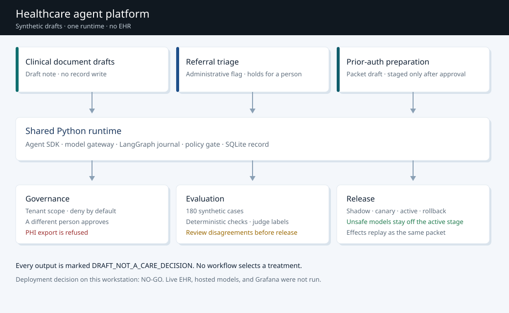
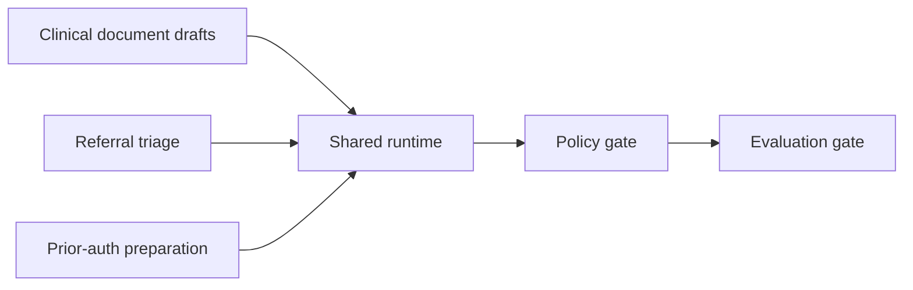

# Healthcare Agentic AI Platform

Self-directed simulation of a shared agent runtime for three synthetic healthcare workflows: clinical document drafts, referral triage, and prior-authorization preparation. The workflows return draft recommendations. They do not make care decisions, and this repository is not a clinically validated product.

The shape under study is a single integration layer, registered workflows, one governance path, and evaluation that can block a release. The implementation is independent of any vendor platform.





## What the three workflows do

| Workflow | Draft | Consequential action |
| --- | --- | --- |
| `clinical-document-draft` | A note with reason and findings | None. Status `DRAFT_READY`. |
| `referral-triage` | An administrative priority flag copied from the case | `recommendation.release` after a different person approves |
| `prior-auth-prep` | Completeness, service code, and policy id | `packet.stage` after a different person approves |

Every stored output includes `DRAFT_NOT_A_CARE_DECISION`. A client field named `approved` is rejected by the request schema. Approval is a second call by an actor who did not request the run and who holds `workflow.approve`.

Tenant `SYN-TENANT-NORTHBRIDGE`, organization `SYN-ORG-NORTHBRIDGE`. Bearers are fixtures in `identity.py`. They are not tokens from a live OIDC issuer.

## Shared package

`healthcare-agentic-ai-platform` version `0.1.0` (`healthcare_platform`). One `Platform` registers workflows on one `GraphRuntime`.

The SDK surface is small on purpose:

- `RegisteredWorkflow` and `compose` for a workflow
- `ModelGateway` for routing
- `ToolGate` for chart read and the denied PHI export
- `score_behavior` and `release_reasons` for evaluation
- `Registry` for shadow, canary, active, and rollback

LangGraph 1.2 runs five nodes: `retrieve_chart`, `choose_model`, `compose_draft`, `check_schema`, `apply_policy`. That version replaces the dict state with each node return, so each node copies the state forward. Finished steps are also written to SQLite. A retry of a `FAILED` run returns the saved step instead of repeating the tool call.

## Routing

Configured cards, not measured dollars:

| Model | Quality | Cost units | Latency units | Available |
| --- | ---: | ---: | ---: | --- |
| `mock-governed` | 0.95 | 8 | 30 | yes |
| `mock-alternate` | 0.96 | 12 | 40 | yes |
| `mock-cheap` | 0.78 | 1 | 5 | yes |
| `mock-down` | 0.99 | 4 | 10 | no |

The floor is 0.9. Among available models at or above the floor, the gateway picks the lowest cost, then the lowest latency. With the defaults that is `mock-governed`. If every model above the floor is unavailable, the gateway fails over to the cheapest available model and marks `failover`. Cost units and latency units are configuration. The wall clock of a run is a separate field.

## Evaluation

Dataset `cases-v1-seed-21` has 180 synthetic cases, 60 for each workflow. Twelve cases, one in every fifteen, carry a judge label that disagrees with the expert label. The judge is that stored label. It is not a live model call. Promotion of any model waits until those twelve disagreements are reviewed.

Offline exact match on this dataset, from `benchmarks/latest.json`:

| Behavior | Exact matches | PHI leaks |
| --- | ---: | ---: |
| governed | 180 / 180 | 0 |
| cheap | 140 / 180 | 0 |
| regressed | 40 / 180 | 0 |
| leaky | 0 / 180 | 180 |

`mock-governed` and `mock-alternate` both use the governed composer. `mock-cheap`, `mock-leaky`, and `mock-regressed` fail the release gate. A rejected promotion is audited and is not written as a release. `ineligible_promotions` stays 0 because an ineligible model is not promoted.

The active stage also refuses a model whose exact match is below the current active model. Shadow does not serve traffic. Canary serves when `zlib.crc32(case_id) % 10 == 0`. Rollback restores the last retired active model.

## Governance checks the tests lock

- Protected tool `phi.export` is denied for every fixture. Accepted protected actions in the tool gate stay 0.
- A requester in `SYN-TENANT-SOUTHLINE` cannot run a Northbridge case.
- Chart read returns administrative fields. Patient tokens and MRNs are not in the tool payload.
- Leaky drafts are blocked. Persisted output, traces, and audit rows are scanned for `SYN-PHI-`.
- Executing the same packet twice returns the first effect with `idempotent: true` and does not insert a second row.
- An injected failure after chart read is journaled. The retry does not read the chart again.

## Measured run time

`scripts/benchmark.py` ran 30 fresh platform runs on this workstation. Hardware from the CIM query in that run: 11th Gen Intel(R) Core(TM) i7-1185G7 @ 3.00GHz, 4 cores, 8 logical processors, Python 3.12.10. Free physical memory was 9432996 KB of 32916868 KB.

| | Seconds |
| --- | ---: |
| min | 0.006101000006310642 |
| median | 0.007051650005450938 |
| max | 0.010512499997275881 |

`price` is `none`. Those seconds are in-process SQLite and Python. They are not a hosted model round trip.

## Run it

```text
python -m venv .venv
.venv\Scripts\python.exe -m pip install -e ".[dev]"
.venv\Scripts\python.exe -m pytest
.venv\Scripts\python.exe -m healthcare_platform demo
.venv\Scripts\python.exe -m healthcare_platform serve
```

`serve` binds `127.0.0.1:8000`. `GET /health` reports adapter gates and does not open a socket. `GET /metrics` is Prometheus text. `GET /api/v1/reports/models` is the quality, latency-unit, and cost-unit comparison.

A new workflow starts from `template-echo`. Register a `Case`, then call `run`. The steps are in [docs/onboarding.md](docs/onboarding.md). Catalog cases are not added by that template.

## Layout

| Path | Role |
| --- | --- |
| `src/healthcare_platform` | Runtime, gateway, policy, evaluation, registry, API |
| `tests` | Acceptance checks. Postgres test skips unless `DATABASE_URL` is a local postgres URL |
| `benchmarks/latest.json` | The measurement above |
| `api/openapi.json` | Schema exported from the FastAPI app |
| `docs/adr` | Build-versus-buy and technology notes |
| `deploy` | Kubernetes sketch with `applied: false`, Grafana dashboard not imported |

## Limitations

Deployment decision: **NO-GO**.

Docker and kubectl were not used on this workstation. The image proof is the GitHub Actions `docker-build` job, which builds the image and runs `docker compose config` without starting the stack. Local compose was not started. Grafana, a Redis or Kafka broker, a live OIDC issuer, a live LLM judge, Temporal, and an EHR were not run. Postgres is used only by the Actions integration job when that job is green. Unset adapter URLs stay `not-run`. Any other host is blocked, the process does not dial, and the error text does not include the URL.

MLflow 3 file storage is in maintenance mode here. Tracking uses a SQLite URI when a caller passes one. The store is gitignored. Committed evidence is the JSON file.

This repository was written in a Grok Build session. See [docs/ai-sdlc.md](docs/ai-sdlc.md).

## License

MIT. Copyright 2026 Jatinder Singh.
